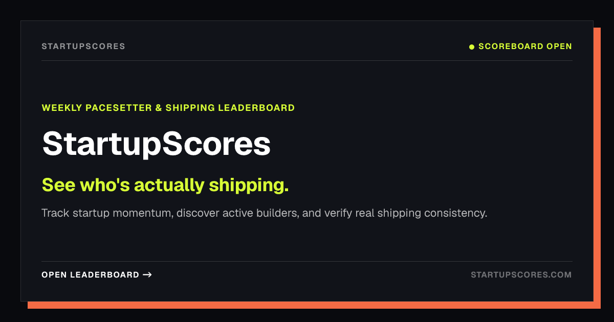
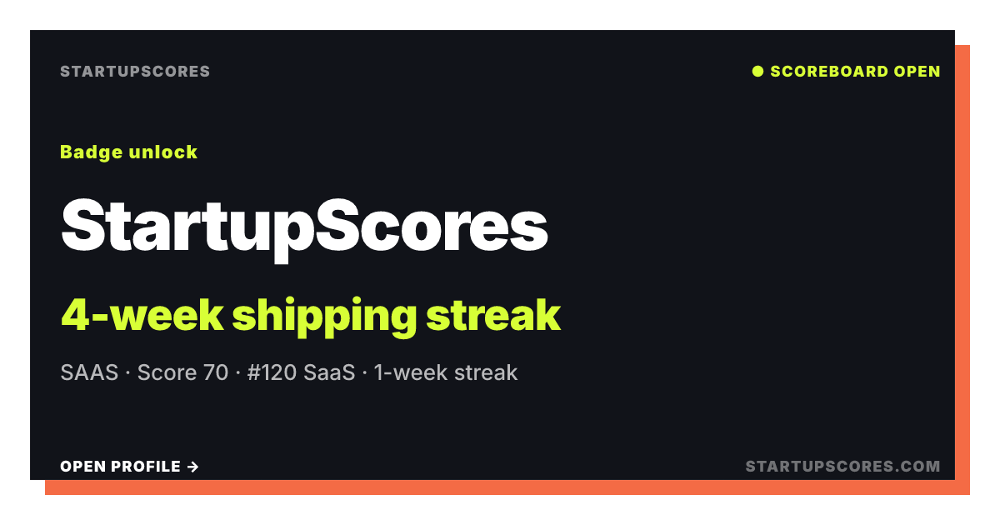
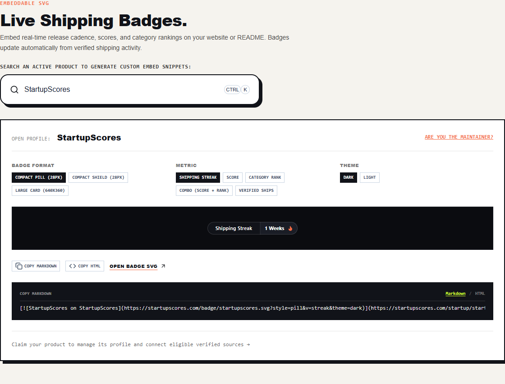

# StartupScores Bot

The official badge helper for [StartupScores](https://startupscores.com), an evidence-based scoreboard for software startups and open-source projects.

We help maintainers show their project's shipping momentum with a live README badge. Follow the badge to see the project's public profile, verified sources, and shipping history.

**[Explore StartupScores](https://startupscores.com) · [Browse open source](https://startupscores.com/#open-source) · [How scoring works](https://startupscores.com/methodology)**

## Built for people who ship

Discover active builders, explore startup and open-source rankings, and follow the public evidence behind each score. Here is StartupScores' own share card, generated by the same product we build for other makers.

## Our badges, on our own project

Compact badges fit alongside the existing badges in a README. Larger cards bring the same project signals to a website or project page. These examples link to our own public profile and update automatically.

| Dark card                                                                                                                                                                                 | Light card                                                                                                                                                                                          |
| ----------------------------------------------------------------------------------------------------------------------------------------------------------------------------------------- | --------------------------------------------------------------------------------------------------------------------------------------------------------------------------------------------------- |
|  |  |

Explore all 30 live badge and banner alternatives

Every example below uses StartupScores' own project data: three formats, five metrics, and two themes. Click a badge to open our public profile.

### Shield · compact and rectangular

| Metric                | Dark                                                                                                                                                                                               | Light                                                                                                                                                                                                |
| --------------------- | -------------------------------------------------------------------------------------------------------------------------------------------------------------------------------------------------- | ---------------------------------------------------------------------------------------------------------------------------------------------------------------------------------------------------- |
| Shipping score        |         |         |
| Shipping streak       |       |       |
| Category rank         |           |           |
| Score + category rank |  |  |
| Verified ships        |          |          |

### Pill · compact and rounded

| Metric                | Dark                                                                                                                                                                                           | Light                                                                                                                                                                                            |
| --------------------- | ---------------------------------------------------------------------------------------------------------------------------------------------------------------------------------------------- | ------------------------------------------------------------------------------------------------------------------------------------------------------------------------------------------------ |
| Shipping score        |         |         |
| Shipping streak       |       |       |
| Category rank         |           |           |
| Score + category rank |  |  |
| Verified ships        |          |          |

### Card · larger banners for websites and project pages

| Metric                | Dark                                                                                                                                                                                           | Light                                                                                                                                                                                            |
| --------------------- | ---------------------------------------------------------------------------------------------------------------------------------------------------------------------------------------------- | ------------------------------------------------------------------------------------------------------------------------------------------------------------------------------------------------ |
| Shipping score        |         |         |
| Shipping streak       |       |       |
| Category rank         |           |           |
| Score + category rank |  |  |
| Verified ships        |          |          |

To customize these examples for your project, select it in the [live badge picker](https://startupscores.com/badges). You can copy both Markdown and HTML directly from the preview.

## What a badge looks like

These are live badges for projects whose maintainers merged a StartupScores badge PR. The values update as the projects ship.

| Project                                                            | Live README badge                                                                                                                                                        | Merged contribution                                                       |
| ------------------------------------------------------------------ | ------------------------------------------------------------------------------------------------------------------------------------------------------------------------ | ------------------------------------------------------------------------- |
| [Finalibaba](https://startupscores.com/open-source/finalibaba)     |        | [View PR #59](https://github.com/LoicSERRE/finalibaba-selfhosted/pull/59) |
| [Just Arrived](https://startupscores.com/open-source/just-arrived) |  | [View PR #1](https://github.com/sharma-open-source/just-arrived/pull/1)   |
| [TenantLayer](https://startupscores.com/open-source/tenantlayer)   |     | [View PR #33](https://github.com/tenantlayer-io/tenantlayer/pull/33)      |

## More ways to show your progress

Choose a compact shield or pill for a README, or a larger card for a project website. Customize the metric and light or dark theme in the [badge gallery](https://startupscores.com/badges).

## What sits behind the badge

StartupScores follows public shipping evidence, including GitHub activity, package releases, and official changelogs. Scores describe recent shipping, consistency, intensity, and streaks. Revenue, funding, followers, and GitHub stars do not raise a shipping score.

Read the [scoring methodology](https://startupscores.com/methodology) and follow each project's source links to inspect the evidence.

## Received a pull request from us?

- It proposes a documentation-only change: a linked badge in your README.
- It does not install a package or add a workflow, dependency, or tracking script.
- Merging is optional. If a badge is not a fit for your project, you are welcome to close the PR.

Want a badge for your own project? Open its StartupScores profile and copy the Markdown or HTML from the badge picker. Visit the [badge gallery](https://startupscores.com/badges) to explore the available formats.

For questions or incorrect project information, [contact StartupScores](https://startupscores.com/contact).

---

[StartupScores](https://startupscores.com) · See who's actually shipping.
